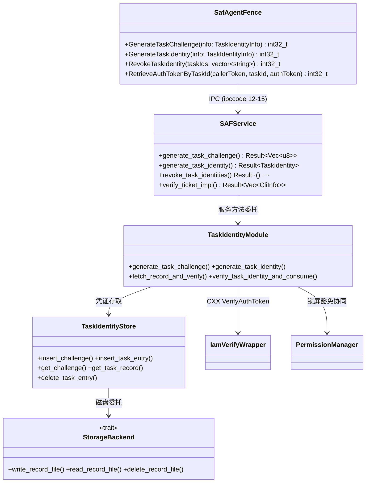
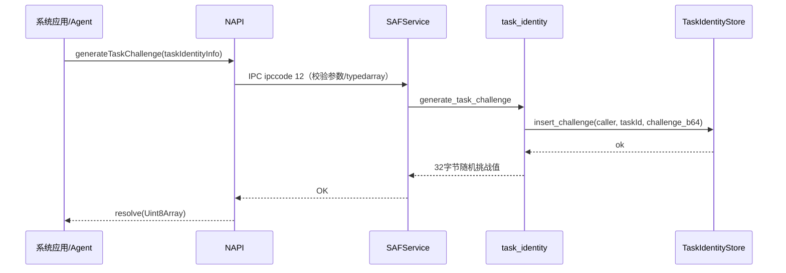
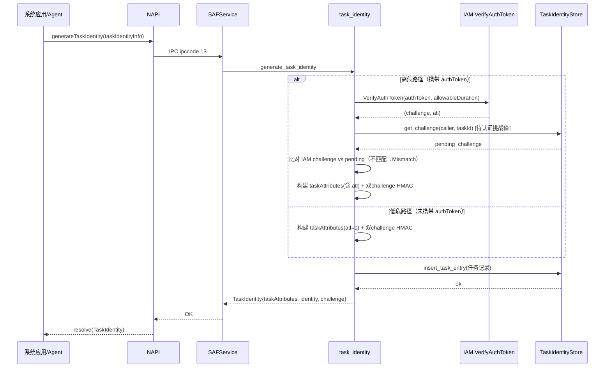
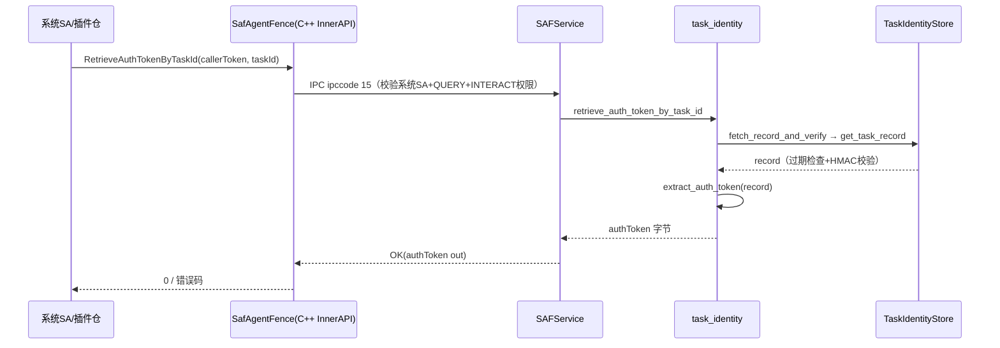
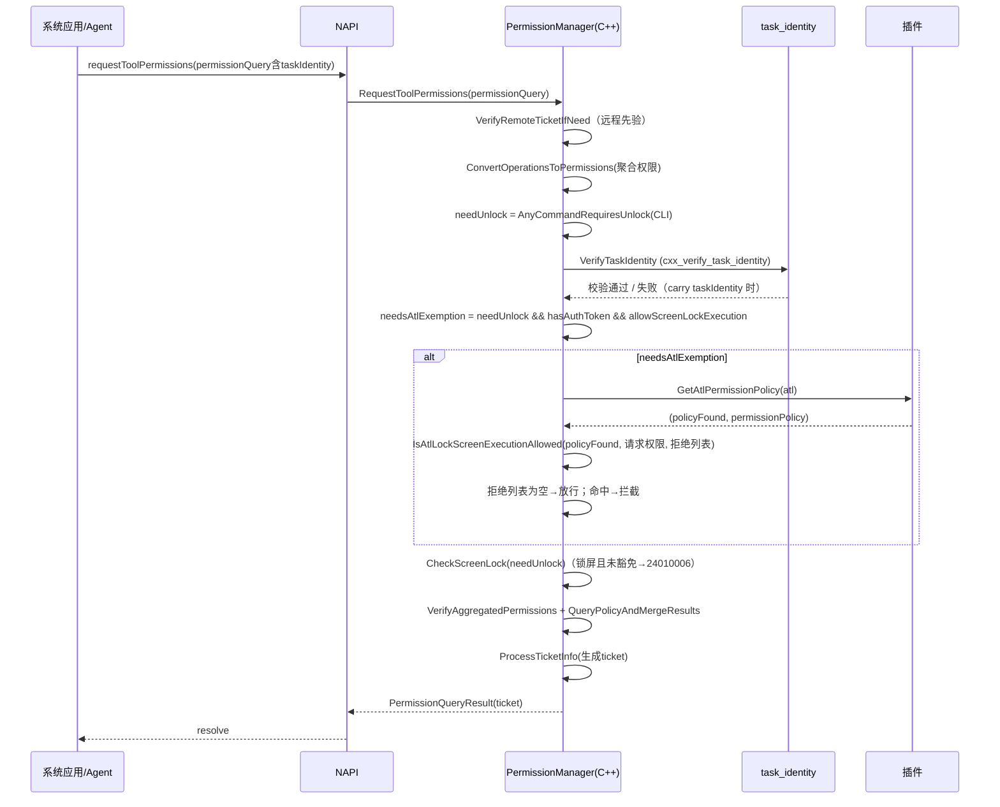
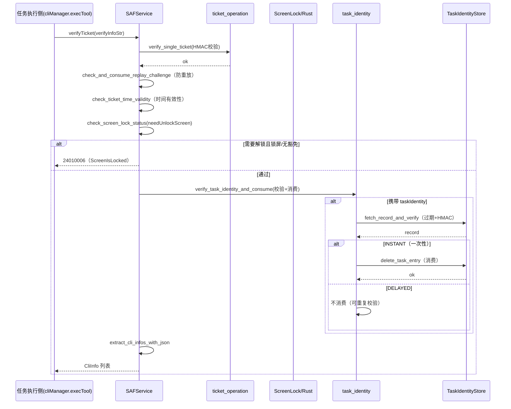
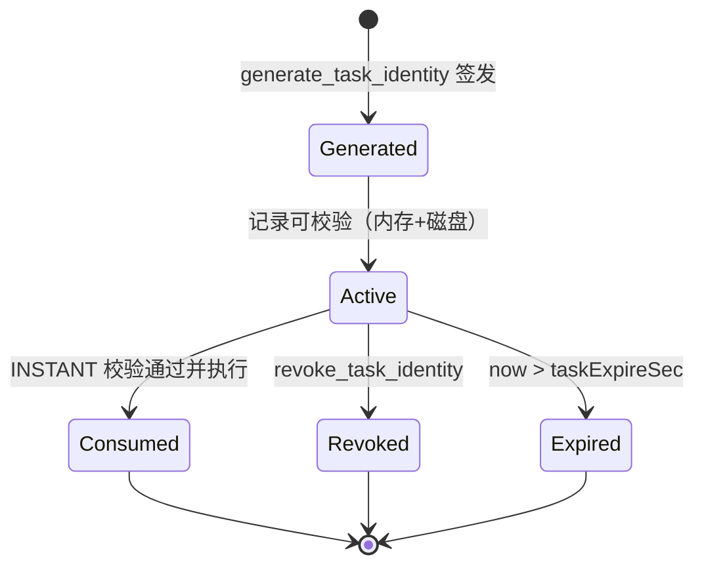
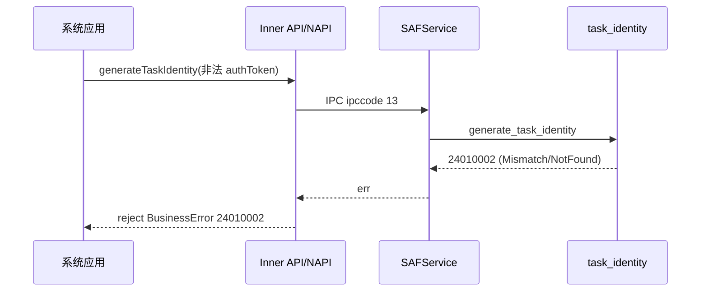

# 架构设计

> 确认目标仓和模块的架构约束、关键设计决策、Spec 拆分方向。

## 设计元数据

| 字段 | 内容 |
|------|------|
| Design ID | DESIGN-20260905541319 |
| 关联需求 | `.codespec/changes/20260905541319/proposal.md` |
| 关联 Epic | 无 |
| 目标 Feature | FEAT-20260905541319（任务级身份凭证支撑 Agent 长时/定时任务在锁屏下执行） |
| 复杂度 | 复杂 |
| 目标版本 | OpenHarmony 7.1（proposal.target_release） |
| Owner | Lin Shen |
| 状态 | Approved |

## 需求基线

> 需求基线详见 proposal.md。以下仅列出设计阶段需要额外强调的要点。

| 项 | 补充说明 |
|----|----------|
| 代码基线 | 基线 `7e1109015c5941f014d9cf0421f528351a3b9c07` 仅含 ticket 链路；**任务级身份凭证（Task Identity）全部为本次新增**。实际开发内容对应提交 `cd731e5b0d94c262a6f1f1d7a4b28ae451052f38`（task identity 生成/撤销/存储/IAM 桥）+ `fc582502b877fc00a5cf4968056173fa916d8bfa`（锁屏豁免 + 验证脊柱重构 + get_atl_permission_policy 插件事件） |
| 锁屏豁免 | ATL3(30000)/ATL4(40000) 为有效可豁免机主认证强度，当前锁屏拒绝权限列表为空 → 放行（spec AC-2.1~2.3，C-5 已确认最终规格） |
| 一次性任务语义 | 一次性（INSTANT）任务凭证校验通过并执行后不可再次通过校验；延时（DELAYED）可重复通过（spec AC-3.1，R-9） |
| 权限口径 | `allowableDuration` 声明文件侧约束 `(0,60]` 为最终对外口径（C-3 已确认）；实现侧当前常量 `MAX_ALLOWABLE_DURATION=86400` 需对齐（见风险） |

## 上下文和现状

### 涉及仓和模块

| 仓库 | 补充架构说明 |
|------|-------------|
| `security_asset` | 主实现仓。SAF（Secure Access Fence）系统服务；本设计涉及 NAPI 层（ArkTS System API 入口）、Inner API（C++）、IPC（Rust stub + IDL）、SA 服务（Rust + CXX 桥）、插件(闭源) 事件交互。复用既有 ticket 链路（`requestToolPermissions` 双 challenge HMAC）扩展任务级身份。 |
| `interface_sdk-js`（声明仓） | `D:\@ohos.abilityToolAccessCtrl.d.ts` 为权威声明；`generateTaskChallenge`/`generateTaskIdentity`/`revokeTaskIdentity` System API + 相关类型已合入（MR 36745，C-2 确认）。 |
| `selinux_adapter` | 锁屏/AI 任务相关 SELinux 策略（`secure_access_fence.te` 的 IAM 调用权限）在该仓完成，本仓不交付（C-4 确认）。 |

### 代码事实基线

> 只记录**基线 `7e110901` 中已有、本次设计必须兼容/复用的现状**（文件:行/符号，源码验证）。本次新增的能力（task_identity 模块等）非"既有事实"，归入「关键设计决策」「设计骨架」「后续 Task 拆分」表述其设计意图；实现细节由 execution-plan/Task 承载。

| 代码引用（基线 7e110901，文件:行/符号） | 基线现状事实 | 关联架构规则 | 对本设计的约束 | 验证来源/可信度 |
|-------------------------|------------|--------------|----------------|-----------------|
| `services/secure_access_fence/core_service/src/ticket_operation/mod.rs:164 / create_ticket_key_manager`、`:172 / batch_generate_ticket`、`:232 / batch_verify_ticket` | 基线已有双 challenge HMAC ticket 生成/验证链路（challenge1 派生 session_key、challenge2 入 HMAC 数据；`taskAttributes` 内嵌 callerTokenId） | OH-ARCH-API-LEVEL | **本设计任务身份凭证必须复用该模式**（同构 HMAC，验证时无需区分生成/验证 caller），不得另起新凭证体系 | 源码，高 |
| `services/secure_access_fence/core_service/src/ticket_operation/ticket_key_manager.rs:20 / trait TicketKeyManager`、`:21 derive_ticket_session_key` | 基线选择性 key manager 抽象，`derive_ticket_session_key(os_account_id, hw_account_id, derive_factor)` | OH-ARCH-API-LEVEL | 任务身份 HMAC 复用 `derive_ticket_session_key`（以 challenge1 为 derive_factor），不得绕过 | 源码，高 |
| `services/secure_access_fence/core_service/src/lib.rs:652 / verify_ticket_impl` | 基线 verifyTicket 链路：`verify_single_ticket` → `check_and_consume_replay_challenge` → `check_ticket_time_validity_with_json` → `check_screen_lock_status` → `extract_cli_infos_with_json`（**基线不含任务身份校验**） | OH-ARCH-IPC-SAF | **本次在该链路插入任务身份校验（`verify_task_identity_and_consume`），插入点位于锁屏检查之后、提取 CliInfo 之前；未携带 taskIdentity 时行为不变** | 源码，高 |
| `services/secure_access_fence/core_service/src/lib.rs:625-650 / check_screen_lock_status` | 基线锁屏检查：依据消息 `needUnlockScreen` 字段 + `cxx_is_screen_locked`，锁定则返回 `ErrCode::ScreenIsLocked`(0x22002) | OH-ARCH-IPC-SAF | 本次锁屏豁免是**对基线锁屏检查的条件性放行**，不得绕过基线基础检查（未携带豁免任务时保持基线行为） | 源码，高 |
| `services/secure_access_fence/core_service/src/lib.rs:275-301 / batch_generate_ticket`（SAFService 方法）+ `stub.rs` 分发 | 基线 SAFService 方法注册与 stub 分发模式（ipccode→handler） | OH-ARCH-IPC-SAF | 新增 ipccode 12-15 按既有 stub 分发模式接入，服务侧独立鉴权 | 源码，高 |
| `frameworks/secure_access_fence/inner_api/ipc/ISecureAccessFence.idl:1-11,90-133`（基线） | 基线 IDL 契约（ticket/远程控制 ipccode 1-11、500-502），无任务身份接口 | OH-ARCH-IPC-SAF | 新增 4 个任务身份方法放同一 IDL（ipccode 12-15），保持契约风格一致 | 源码，高 |
| `frameworks/common/napi/src/napi_common.cpp:40-68 / MapErrorCode` + `frameworks/secure_access_fence/js/napi/inc/agent_fence_error_codes.h` | 基线 NAPI 错误码映射表；`SAF_ERR_SCREENLOCK_IS_LOCKED(0x22002)` → `OPERATION_FAILED_UNDER_SCREEN_LOCK=24010006` | OH-ARCH-ERROR-LOG | 新增内部码必须纳入同一映射表；锁屏拦截复用 24010006 映射 | 源码，高 |
| `interfaces/inner_kits/c/secure_access_fence/common/inc/saf_result_defs.h:34,88-95` | 基线错误码域定义含 `TICKET_OPERATION=0x71000`（1/2 已用）；**基准代码 0x71005-8 不存在** | OH-ARCH-ERROR-LOG | 新增任务身份内部码置于 `TICKET_OPERATION` 域（| 5..8），不扩展新域 | 源码，高 |
| `interfaces/inner_kits/c/secure_access_fence/agent_fence/inc/saf_agent_fence.h:95-196` | 基线 C++ Inner API 方法集（RequestToolPermissions / RequestToolTicket / QueryStaticCliCmdPermissions / GrantToolPermissionsByUser / 远程控制），无任务身份方法 | OH-ARCH-API-LEVEL | 4 个任务身份方法追加到同一 C++ 类（`SafAgentFence`），对齐既有签名风格 | 源码，高 |
| `frameworks/asset/definition/src/macros.rs:134` + `frameworks/secure_access_fence/definition/src/macros.rs:151,171` | 基线错误提升宏 `log_throw_error!` / `log_and_into_saf_error!`；`crates.oz` | OH-ARCH-ERROR-LOG | 任务身份模块复用统一错误宏，不新建 | 源码，高 |

**基线规则确认：**
- 上述"既有事实"均以基线提交 `7e110901` 内容为准（经 `git show 7e110901:...` 核对），可信度高。
- **基线中不存在**：`task_identity/` 模块、`GetAtlPermissionPolicy` 插件事件、`verify_task_identity_and_consume`、内部码 0x71005-8、ipccode 12-15、`MAX_AUTH_TOKEN_SIZE` 等。以上全部为**本次新增**，其设计意图见「关键设计决策」「设计骨架」章节，不对基线事实形成约束。
- 实现内容（相对 `7e110901`）由提交 `cd731e5b` + `fc582502` 交付；本文档记录的是它的**设计**，非将其宣称为基线既有事实。

### 调用链层级分析

| 层 | 模块 | 职责 | 修改类型 |
|----|------|------|----------|
| NAPI（JS 入口） | `frameworks/secure_access_fence/js/napi/src/agent_fence_napi.cpp` | `generateTaskChallenge`/`generateTaskIdentity`/`revokeTaskIdentity` 的 ArkTS 入口，参数校验 + typedarray 校验（u8_list 逐元素转换） | 新增 |
| Inner API（C++ 入口） | `interfaces/.../agent_fence/inc/saf_agent_fence.h:205-239` | 静态方法签名 + proxy 调用（GenerateTask* / RevokeTaskIdentity / RetrieveAuthTokenByTaskId） | 新增 |
| IPC | `frameworks/secure_access_fence/inner_api/ipc/`（IDL + Rust `sub_modules/task_identity.rs`） | ipccode 12-15 序列化/反序列化 + `deserialize_i32_u8_list` 范围校验 | 新增 |
| SAF 服务（Rust） | `services/secure_access_fence/core_service/src/stub.rs` + `lib.rs` | IPC 分发、服务侧权限校验（`check_query_tool_permission` / `check_retrieve_auth_token_permission`）、`verify_ticket_impl` 集成任务校验 | 修改 |
| 任务身份模块 | `services/secure_access_fence/core_service/src/task_identity/`（mod/store/storage_backend/validator） | 挑战生成、身份签发（双 challenge HMAC + IAM 绑定）、撤销、校验（脊柱）、消费、持久化 | 新增 |
| CXX 桥 | `services/secure_access_fence/core_service/src/wrapper.rs` + `cxx/src/cxx_bridge_functions.h` | Rust↔C++ 边界：`VerifyAuthToken`（IAM）、`get_atl_permission_policy`（插件）、`cxx_verify_task_identity` | 新增 |
| IAM | `cxx/src/iam_verify_wrapper.cpp` | `UserAccessCtrlClient::VerifyAuthToken` 同步等待，返回 (challenge, atl)；10 秒超时 | 新增 |
| 插件（闭源） | `EventType::GetAtlPermissionPolicy` / `GetPolicyAuthStatus` | 锁屏拒绝权限策略与授权策略来源 | 扩展事件（新增 GetAtlPermissionPolicy=10） |

**检查项：**
- [x] 调用链每一层都已覆盖（NAPI → Inner API → IPC → SAF 服务 → 任务身份模块 → CXX 桥 → IAM/插件）
- [x] 每层职责边界清晰，无跨层违规调用（Rust 不直接触碰 IAM/插件，经 wrapper 桥）
- [x] 每层修改类型明确

### 适用架构规则

| Rule ID | 适用原因 | 设计结论 | 验证方式 |
|---------|----------|----------|----------|
| OH-ARCH-IPC-SAF | 新增 IPC ipccode 12-15 + Inner API 跨进程 | 服务侧 stub 独立权限校验；IPC 载荷校验（u8 范围）；错误码/异常透传；任务校验在 verifyTicket 内先行 | 代码评审/集成测试 |
| OH-ARCH-API-LEVEL | 新增 3 System API + 1 InnerAPI + 类型 | 级别=System/InnerAPI；权限 `QUERY_TOOL_PERMISSIONS`；@since 26.1.0；错误码精确；兼容既有 ticket 链路 | API 评审/XTS |
| OH-ARCH-COMPONENT-BUILD | 新增 `user_auth_framework` 依赖、独立 CXX 桥 | `bundle.json`/`BUILD.gn` 声明 IAM 依赖；`iam_verify_wrapper.cpp` 作为独立 target | 构建验证 |
| OH-ARCH-ERROR-LOG | 新增内部码 0x71005-8 / 复用 24010006 | 对外映射稳定；错误日志脱敏（不外泄 authToken/ATL） | 单测/hilog |

### 既有模式复用

> 只列**基线 `7e110901` 中已存在**、本次直接复用的模式。本次新增的抽象（如 StorageBackend 磁盘/内存分离、LruMap）不属于"既有复用"，其设计意图在「关键设计决策 ADR-4」中表达，此处不复用表承载。

| 模式 | 参考代码（基线 7e110901，文件:行/符号） | 适用架构规则 | 必须复用的约定 | 本设计的复用方式 | 偏差及理由 | 关联 Task |
|------|-------------------------|-------------|----------------|------------------|------------|-----------|
| 双 challenge HMAC ticket | `ticket_operation/mod.rs:164 / create_ticket_key_manager`、`:172 / batch_generate_ticket`、`:232 / batch_verify_ticket` | OH-ARCH-API-LEVEL | challenge1 派生 session_key、challenge2 入 HMAC 数据、`taskAttributes` 内嵌 callerTokenId | 直接复用模式生成任务身份凭证 | 无 | TASK-2 |
| Ticket key manager 抽象 | `ticket_operation/ticket_key_manager.rs:20-21 / trait TicketKeyManager / derive_ticket_session_key` | OH-ARCH-API-LEVEL | 会话密钥派生经 key manager 抽象统一入口 | 直接复用 | 无 | TASK-2 |
| 错误处理宏 | `frameworks/asset/definition/src/macros.rs:134`（`log_throw_error!`）、`frameworks/secure_access_fence/definition/src/macros.rs:151,171` | OH-ARCH-ERROR-LOG | 统一错误提升/日志，不外泄敏感 | 直接复用 | 无 | TASK-1~TASK-5 |
| IPC stub 分发模式 | `core_service/src/stub.rs:97`（基线 CMD→handler 分发 match 分支，如 `CMD_BATCH_GENERATE_TICKET => handle_batch_generate_ticket`） | OH-ARCH-IPC-SAF | 新增 CMD 按既有 match 分支接入；服务侧鉴权 | 扩展既有分发表 | 无 | TASK-1 |
| NAPI 错误码映射 | `frameworks/common/napi/src/napi_common.cpp:40-68 / MapErrorCode` | OH-ARCH-ERROR-LOG | 内部码→对外 BusinessError 统一走映射表 | 扩展映射表新增内部码 | 无 | TASK-1, TASK-4 |

> **检索结论：** 针对"磁盘/内存分离存储抽象"与"LRU 缓存"两类模式，检索了基线 `7e110901` 的 `ticket_operation/`、`asset/common/`、`secure_access_fence/common/`，确认**基线无既有存储抽象与 LRU 先例**（`asset/common/src/task_manager.rs` 是任务线程池管理，与凭证存储无关）。故 StorageBackend/LruMap 为本次新增设计（ADR-4），无 prior art。

## 不涉及项承接

> proposal「不涉及项确认」标记"涉及"并需展开设计的维度。

| 维度 | 设计结论 |
|------|----------|
| 性能 | 校验进入锁屏执行冷路径。设计给出时延预算目标：`get_atl_permission_policy`（插件事件）与 `verify_record_hmac` 在锁屏拉起路径上的开销应最小化；凭证校验复用内存优先 LRU（磁盘兜底），避免锁屏路径无谓磁盘读。预算精确值在 Plan 阶段落（proposal 资源开销审视 review-required）。 |
| 安全/权限 | 详见下方「安全基础检查」。服务侧 stub 独立鉴权（OH-ARCH-IPC-SAF）：Generate*/Revoke 要求系统应用 + `QUERY_TOOL_PERMISSIONS`；Retrieve 要求系统 SA + QUERY + `INTERACT_ACROSS_LOCAL_ACCOUNTS`（跨用户交互权限）。 |
| 兼容性 | 未携带 taskIdentity 时，`requestToolPermissions`/`verifyTicket` 行为与基线完全一致（R-10/AC-2.4）。新增 API 不与既有 API 冲突，@since 26.1.0。 |
| API/SDK | 3 个 System API + 1 个 InnerAPI。`D:\@ohos.abilityToolAccessCtrl.d.ts` 为权威声明（已合入）。 |
| IPC/跨进程 | IDL ipccode 12-15 新增；序列化/反序列化 + u8 范围校验在 Rust 侧完成；服务侧 stub 鉴权。 |
| 构建/组件 | `bundle.json`/`BUILD.gn` 新增 `user_auth_framework` 依赖与 `iam_verify_wrapper` target。SELinux 配置在 `selinux_adapter` 仓（C-4）。 |

## 关键设计决策

| 决策 ID | 问题 | 推荐方案 | 探索过的替代方案 | 取舍理由 | 影响 |
|---------|------|----------|-----------------|------|------|
| ADR-1 | 任务身份凭证如何生成以保证防篡改、可校验？ | 复用既有 ticket 链路**双 challenge HMAC 模式**：challenge1 派生 session_key、challenge2 入 HMAC 数据、`taskAttributes` 内嵌 callerTokenId； identity=base64(HMAC(taskAttributes+taskId+challenge2)) | A：独立新建凭证体系（新 key 管理、新校验器）——与 ticket 链路完全解耦但引入重复路径与迁移成本；B：单向签名（无 challenge）——无法绑定认证会话与防重放 | 与基线 ticket 链路同构，验证端可复用 `create_ticket_key_manager`/HMAC 基础件；HMAC 覆盖 callerTokenId 防止调用方伪冒；不引入动态调用方 uid 拼接，验证方无需区分生成/验证 caller | 任务凭证签发与校验路径（TASK-2） |
| ADR-2 | 锁屏豁免如何判定？ | ATL 分级锁屏策略：任务凭证声明 `allowScreenLockExecution=true` 且含有效 authToken（高危签发）时，请求 ATL 对应的**锁屏拒绝权限策略**（插件 `GetAtlPermissionPolicy`），请求权限不在拒绝列表即放行 | A：仅凭 `needUnlockScreen` 字段判定（基线已有）——无法区分"用户本人认证后的任务豁免"与普通调用；B：阈值判定（ATL>=X 即放行）——无法表达按权限粒度控制 | 权限粒度可控（不同 ATL 可配不同拒绝列表）；ATL3(30000)/ATL4(40000) 已验证，当前拒绝列表为空→全放行（已确认）；策略来源插件便于安全侧集中配置 | 锁屏执行管控（TASK-4） |
| ADR-3 | 一次性任务"执行后不可再校验"如何实现？ | **执行后删除本地记录**：`verify_task_identity_and_consume` 校验通过后对一次性任务删除（内存+磁盘） | A：状态字段标记（consumed）+ 保留记录——需额外状态管理与过期清理；B：仅内存标记——重启后记录复活，语义不一致 | 删除即天然幂等、重启后不复活；无额外状态机；DELAYED 不删除保持可重复校验 | 一次性任务语义（TASK-5） |
| ADR-4 | 任务凭证存储与一致性？ | 磁盘 source of truth + 内存 LRU 32（entries/challenges 各 32）；`StorageBackend` trait 抽象磁盘/dock | A：纯内存——SA 重启丢失；B：每任务独立锁文件——复杂；C：全局单写者 Mutex + per-record 文件 | 磁盘保证跨 SA 生命周期；LRU 有界防 DoS（~24KB）；StorageBackend 使 store.rs 零 `#[cfg]`（测试用 Mock） | 存储与生命周期（TASK-3） |
| ADR-5 | IAM 机主认证如何接入？ | CXX 桥封装 `UserAccessCtrlClient::VerifyAuthToken`（`iam_verify_wrapper.cpp`，SyncVerifyCallback + 10s 超时），返回 (challenge, atl)；SELinux 在 `selinux_adapter` 仓 | A：Rust 直接调用 IAM——跨语言绑定成本高；B：打桩 ATL=3——非真实认证不可靠（草稿曾用，已替换） | 真实机主认证；CXX 桥隔离；超时兜底防阻塞 SA | IAM 集成（TASK-2） |
| ADR-6 | `RetrieveAuthTokenByTaskId` 定位？ | 新增 InnerAPI（C++ 入口，无 NAPI），供系统侧校验任务有效性并取回 authToken 字节（输出参数） | A：复用既有 `verify_task_identity`（不返回 authToken）——无法满足"取回 authToken"需求；B：Public API——暴露给三方不安全 | 系统侧内部校验+取数；开放级别 InnerAPI 约束调用方为系统 SA；权限双重校验 | 任务有效性检索（TASK-4） |

## 设计骨架

### 骨架范围

| 骨架项 | 目标 | 不包含 | 验证方式 |
|--------|------|--------|----------|
| Task Identity 模块骨架 | `task_identity/` 5 模块（mod/store/storage_backend/validator）编译通过 | 完整锁屏豁免/消费策略 | 构建通过 |
| IPC/API 骨架 | IDL ipccode 12-15 + NAPI + Inner API 签名 | 业务细节 | 编译/API 快照 |
| 测试骨架 | C++ HWTEST_F（retrieve_auth_token 15 用例）+ XTS 用例入口 | 全场景 | 最小用例通过 |

### 骨架 Spec 拆分

| Task ID | 目标 | 受影响文件 | AC |
|---------|------|------------|-----|
| TASK-SKELETON-1 | 建立 task_identity 模块 + IPC/API 骨架 | `task_identity/*`、IDL、NAPI、saf_agent_fence.h | WHEN 构建通过 THEN 任务身份骨架可被链接 |

## 后续 Task 拆分

| Task ID | 目标 | 受影响文件 | 依赖 |
|---------|------|------------|------|
| TASK-1 | API/IDL 声明 + 骨架 | `SecureAccessFenceType.idl`、`ISecureAccessFence.idl`、`saf_agent_fence.{h,cpp}`、`agent_fence_napi.cpp` | design + spec Approved |
| TASK-2 | 任务身份签发/校验核心 | `task_identity/mod.rs`、`cxx/src/iam_verify_wrapper.cpp` | TASK-1 |
| TASK-3 | 存储（磁盘+LRU） | `task_identity/store.rs`、`storage_backend.rs` | TASK-1 |
| TASK-4 | 锁屏豁免 + 检索 | `permission_manager.cpp`、`wrapper.rs`、`plugin_interface.rs`、`saf_agent_fence.*` | TASK-2, TASK-3 |
| TASK-5 | verifyTicket 集成一次性消费 | `lib.rs`（verify_ticket_impl 编排） | TASK-2, TASK-3 |

## API 签名、Kit 与权限

### 新增 API

| API 签名 | 类型 | Kit | d.ts 位置 | 权限要求 | SysCap |
|----------|------|-----|-----------|----------|--------|
| `generateTaskChallenge(taskIdentityInfo: TaskIdentityInfo): Promise<Uint8Array>` | System | AbilityKit | `@ohos.abilityToolAccessCtrl.d.ts`（D:\@ohos.abilityToolAccessCtrl.d.ts:1297） | `ohos.permission.QUERY_TOOL_PERMISSIONS` | SystemCapability.Security.Asset |
| `generateTaskIdentity(taskIdentityInfo: TaskIdentityInfo): Promise<TaskIdentity>` | System | AbilityKit | 同上（:1215） | `QUERY_TOOL_PERMISSIONS` | SystemCapability.Security.Asset |
| `revokeTaskIdentity(taskId: string[]): Promise<void>` | System | AbilityKit | 同上（:1236） | `QUERY_TOOL_PERMISSIONS` | SystemCapability.Security.Asset |
| `RetrieveAuthTokenByTaskId(callerToken, taskId, authToken)` | InnerAPI | AbilityKit（C++） | `saf_agent_fence.h:236`（无 NAPI） | `QUERY_TOOL_PERMISSIONS`+`INTERACT_ACROSS_LOCAL_ACCOUNTS`（跨用户交互权限） | SystemCapability.Security.Asset |

### 变更/废弃 API

无。既有 `requestToolPermissions`/`grantToolPermissionsByUser`/`requestToolTicket`/`verifyTicket` 对外行为与错误码语义保持不变（未携带 taskIdentity 时）。

## 构建系统影响

### BUILD.gn 变更

```
文件路径: services/secure_access_fence/core_service/BUILD.gn
变更说明: 新增源文件 task_identity/{mod,store,storage_backend,validator}.rs；新增依赖 user_auth_framework:userauth_client；iam_verify_wrapper.cpp 作为 cxx 独立源编译。
```

### bundle.json 变更

```
新增依赖组件: user_auth_framework（IAM VerifyAuthToken 访问）
```

---

## 可选设计扩展

### 架构图

```
NAPI (agent_fence_napi.cpp) → Inner API (saf_agent_fence.h) → IPC (IDL ipccode 12-15 + Rust sub_modules/task_identity.rs)
  → SAF Service (stub.rs + lib.rs) → task_identity/ (mod.rs 签发/撤销/校验/消费 + store.rs LRU + storage_backend.rs 磁盘)
  → CXX 桥 (wrapper.rs) → [IAM VerifyAuthToken (iam_verify_wrapper.cpp)] / [插件 GetAtlPermissionPolicy]
```

### 类图



| 类型/接口 | 现有代码引用或 New | 关系 | 关键职责/签名 | 关联 ADR | 关联 Task |
|-----------|--------------------|------|---------------|----------|-----------|
| `SafAgentFence` | `saf_agent_fence.h:205-239` | 对外入口 | 4 新方法 + 既有方法 | ADR-2/6 | TASK-1 |
| `TaskIdentityModule` | `task_identity/mod.rs` | 核心业务 | 签发/撤销/校验/消费 | ADR-1 | TASK-2 |
| `TaskIdentityStore` | `task_identity/store.rs` | 组合持有 | LRU + StorageBackend 委托 | ADR-4 | TASK-3 |
| `StorageBackend` | `task_identity/storage_backend.rs` | trait 实现 | 磁盘/内存分离 | ADR-4 | TASK-3 |
| `IamVerifyWrapper` | `cxx/src/iam_verify_wrapper.cpp` | CXX 桥 | VerifyAuthToken | ADR-5 | TASK-2 |

### 数据流/控制流

| 步骤 | 调用方 | 被调用方 | 数据/接口 | 说明 |
|------|--------|----------|-----------|------|
| 1 | Agent/系统应用 | NAPI GenerateTaskIdentity | 任务身份信息 | 参数校验（typedarray/authToken≤4096/路径） |
| 2 | NAPI | Inner API SafAgentFence | ipccode 13 | proxy 调用 |
| 3 | Inner API | SAFService::generate_task_identity | IPC 序列化 | 服务侧鉴权（系统应用+权限） |
| 4 | SAFService | 任务身份模块 | TaskIdentityInfo | 低危/高危分路径→双 challenge HMAC→绑定 atl→落库 |
| 5 | 任务执行侧 | verifyTicket | verifInfo | 校验链：ticket→防重放→时间→锁屏→任务校验消费→CliInfo |

### 时序设计

> 覆盖全生命周期关键链路：挑战生成 → 身份签发 → 任务有效性校验 → 锁屏豁免放行 → 执行校验消费。

**T1: 挑战生成（generateTaskChallenge，高危路径前置）**



**T2: 身份签发（generateTaskIdentity，低危/高危双路径；高危需先完成 T1）**



**T3: 任务有效性校验/检索（RetrieveAuthTokenByTaskId，InnerAPI 门禁）**



**T4: 锁屏豁免放行（requestToolPermissions 携带 taskIdentity，锁屏态）**



**T5: 执行校验与一次性消费（verifyTicket 全链路，锁屏态执行/到点拉起）**



### 数据模型设计

```typescript
// 任务身份凭证（System API 返回）
interface TaskIdentity {
  taskAttributes: string; // JSON：taskId/callerTokenId/expireTime/executeType/allowScreenLock/allowableDuration/authToken/atl
  identity: string;       // base64(HMAC_SHA256(taskAttributes+taskId+challenge2))
  challenge: string;      // base64(challenge1+challenge2)
}
interface TaskIdentityInfo {
  taskId: string;
  taskExpireTime: number;         // 秒；-1=DELAYED 永不过期
  executeType: ExecuteType;       // INSTANT=1 / DELAYED=2
  allowScreenLockExecution: boolean;
  authToken?: Uint8Array;         // 高危路径
  allowableDuration?: number;     // 秒；(0,60]
}
```

**存储方案：**

| 数据类型 | 存储方式 | 位置 | 生命周期 |
|----------|----------|------|----------|
| 任务记录（taskAttributes） | 磁盘 JSON + 内存 LRU | `/data/service/el2/{os_id}/secure_access_fence/agent_plugin/taskAttributes/{caller}/{taskId}.json` | 签发→撤销/过期/一次性执行后删除 |
| 待认证挑战值 | 磁盘 JSON + 内存 LRU | `.../taskChallenges/{caller}/{taskId}.json` | 10 分钟超时 |

### 状态归属与不变量

#### 状态归属

| State ID | 状态/资源 | 唯一 Owner | 存储/Key/Index | 创建与初始化 | 读取/更新方 | 清理/恢复/回滚触发 | 并发模型 | 代码事实/规则来源 |
|----------|-----------|------------|-------------------|------------|-------------|--------------------|----------|-------------------|
| STATE-1 | 任务凭证记录（`TaskIdentityRecord`） | `task_identity/store.rs`（`TaskIdentityStore`） | 磁盘 `taskAttributes/{caller}/{taskId}.json` + 内存 LruMap 32 | `generate_task_identity` 签发时创建（任务记录含 HMAC 域） | 写入：签发；读取：fetch_record_and_verify（内存优先/磁盘兜底）；删除：撤销/一次性消费/过期清理 | 撤销删除；一次性执行后删除；on_idle/空闲过期清理；SA 重启磁盘兜底 | 全局 `OnceLock<TaskIdentityStore>` + 内部 Mutex（每 key 串行） | `store.rs:28,35,64` + OH-ARCH-IPC-SAF |
| STATE-2 | 待认证挑战值（pending challenge） | `task_identity/store.rs` | `taskChallenges/{caller}/{taskId}.json` + LruMap | `generate_task_challenge` 创建 | 写入：签发挑战；读取：`verify_iam_and_get_challenge` 比对后消费；删除：比对后/超时清理 | 10 分钟超时清理 | 每 key 串行 | `store.rs:31` + `mod.rs:119` |
| STATE-3 | 锁屏拒绝权限策略缓存 | 插件（闭源）持有 | 插件侧 | 查询时获取（`get_atl_permission_policy`） | 读取：`RequestToolPermissions` 锁屏豁免 | 由插件生命周期管理 | 每次豁免判定查询 | `wrapper.rs:243` + OH-ARCH-IPC-SAF |

#### 不变量追溯

| Invariant ID | State ID / 范围 | 必须始终成立的约束 | 关联 AC | 关联 Task | 验证方式与通过标准 | 违反时处理 |
|--------------|------------------|--------------------|---------|-----------|--------------------|------------|
| INV-1 | STATE-1 | 同一 (os_account_id, caller, taskId) 最多一条有效任务记录；HMAC 校验失败（篡改/不匹配）的记录绝不放行 | AC-3.2, AC-4.3 | TASK-2 | 单测：篡改 identity/challenge 后校验必须失败（24010002/MISMATCH） | 返回 TaskIdentityMismatch；不进入执行 |
| INV-2 | STATE-1 | 一次性（INSTANT）任务在执行校验通过后必须失效（不可再次通过） | AC-3.1, AC-3.2 | TASK-5 | 集成：INSTANT 校验并执行后再校验必须失败；DELAYED 可重复通过 | 二次校验返回 NOT_FOUND / 24010002 |
| INV-3 | STATE-1 | 过期任务（now > taskExpireSec 且非 -1）不通过校验 | AC-3.2, AC-4.3 | TASK-2 | 单测：过期凭证校验失败（EXPIRED） | 返回 24010002 |
| INV-4 | STATE-2 | 待认证挑战值 10 分钟内有效；比对后即废弃 | AC-1.3, AC-1.4 | TASK-2 | 单测：超时/已消费挑战值参与签发必须失败 | 返回 24010002（NOT_FOUND/MISMATCH） |
| INV-5 | STATE-3 | 锁屏豁免放行 = 凭证声明 + ATL 有效 + 策略存在 + 权限不在拒绝列表，四者缺一不放行 | AC-2.1, AC-2.2, AC-2.3 | TASK-4 | 集成：豁免条件矩阵遍历（放行/拦截边界一致） | 拦截返回 24010006 |
| INV-6 | STATE-1/2 | LRU 有界（entries/challenges ≤32），满时淘汰最久未访问且不破坏磁盘一致性 | AC-4.3 | TASK-3 | 单测：挂 33+ 任务后最久未访问被淘汰，磁盘仍可兜底读取 | 淘汰内存条目；磁盘为 source of truth |
| INV-7 | STATE-1 | 由 `allowScreenLockExecution=false`/无豁免声明的任务记录不得被用于锁屏执行放行 | AC-2.2 | TASK-4 | 集成：锁屏态未声明任务返回 24010006 | 拦截 |

### 算法与状态机



| 转移 | 触发条件 | Guard | 状态变化/副作用 | 关联不变量 | 异常与恢复 | 验证方式 |
|------|----------|-------|-----------------|------------|------------|----------|
| Generated → Active | 签发完成 | 缓存写成功 | 记录可读 | INV-1, INV-6 | 磁盘写失败则签发失败 | 单测 |
| Active → Consumed | INSTANT 校验通过并执行 | 校验通过 | 删除记录 | INV-2, INV-6 | 删除失败仅日志（不阻断） | 集成 |
| Active → Revoked | revokeTaskIdentity | 幂等 | 删除记录 | INV-1 | — | 单测 |
| Active → Expired | 超时 | taskExpireSec != -1 | 校验失败 | INV-3 | — | 单测 |
| Generated/Active → 锁屏态判定 | 锁屏态 requestToolPermissions/verifyTicket | 请求权限 + ATL 策略 | 放行或 24010006 拦截（不改变 Active 状态） | INV-5, INV-7 | 拦截不产生副作用 | 集成矩阵 |

### 测试性设计

| 测试层级 | 测试目标 | Mock 策略 | 验证方式 |
|----------|----------|-----------|----------|
| 单元测试（TDD） | task_identity 模块：签发/撤销/校验/过期/消费/LRU | MockStorage 替换 DiskStorage；IAM 走真实桥或可注入 | C++ HWTEST_F（`saf_agent_fence_retrieve_auth_token_test.cpp` 15 用例）+ Rust 单测 |
| 集成测试 | verifyTicket 携带 taskIdentity、锁屏豁免矩阵 | 真实依赖 | HWTEST_F + 测试 HAP |
| XTS | JS 入口 System API（generate*/revoke、requestToolPermissions、verifyTicket） | N/A | XTS 用例/测试 HAP（spec 验证映射 VM-1~13） |

### 异常传播时序图



| 异常场景 | 触发层 | 传播路径 | 最终处理 |
|----------|--------|----------|----------|
| 高危 challenge 不匹配/缺失 | task_identity | generate_task_identity → IPC → NAPI | reject 24010002 |
| 权限不足 | SAFService stub | stub → 调用方 | 201/202 |
| 锁屏未豁免 | permission_manager | RequestToolPermissions/verifyTicket → 调用方 | 24010006 |
| 过期/篡改 | task_identity | 校验脊柱 → 调用方 | 24010002 |
| 参数非法 | validator | 各入口 | 24010000 |

### 资源所有权矩阵

| 资源 / State ID | 创建方 | 持有方（Owner） | 借用/只读消费者 | 销毁触发 | 实际释放 | 异常回收 | 关联不变量 |
|-----------------|--------|----------------|-----------------|----------|----------|----------|------------|
| 任务记录 / STATE-1 | `generate_task_identity` | `TaskIdentityStore` | `fetch_record_and_verify`（只读校验） | 撤销/一次性消费/超时/on_idle | store.delete_task_entry | LRU 淘汰；on_idle 过期清理 | INV-1, INV-2, INV-3, INV-6 |
| 待认证挑战值 / STATE-2 | `generate_task_challenge` | `TaskIdentityStore` | `verify_iam_and_get_challenge`（比对） | 比对后/超时 | store 删除 | 10 分钟超时清理 | INV-4 |
| 锁屏豁免策略 / STATE-3 | 插件（闭源） | 插件 | `RequestToolPermissions` 锁屏豁免判定（只读） | 策略生命周期由插件管理 | 插件侧 | 插件异常时返回不放行（拦截） | INV-5, INV-7 |
| authToken（高危路径） | IAM 认证 | 任务记录（skey 字段） | 检索（RetrieveAuthTokenByTaskId） | 与记录同生命周期 | 随记录删除 | — | INV-1 |

### 接口参数规约

| 接口 | 参数 | 类型 | 合法范围 | 非法处理 | 边界说明 |
|------|------|------|----------|----------|----------|
| generateTaskChallenge/Identity | taskId | string | 非空、≤256、无路径穿越 | 24010000 | 路径穿越 pattern（validator.rs） |
| generateTaskIdentity | authToken | Uint8Array | ≤4096 字节；u8 逐元素 0~255 | 24010000 | 高危专属 |
| generateTaskIdentity | allowableDuration | number | (0,60]（对外）；实现侧当前 86400（待对齐） | 24010000 | C-3 确认 60 |
| generateTaskIdentity | executeType | ExecuteType | INSTANT=1/DELAYED=2 | 24010000 | -1 仅 DELAYED |
| revokeTaskIdentity | taskId | string[] | 1~100 个、非空、无路径穿越 | 24010000 | 幂等 |
| RetrieveAuthTokenByTaskId | callerToken/taskId | int32/string | 系统 SA 身份 + taskId 合法 | 201/24010000/24010002 | 服务侧双重权限 |

### 线程与并发模型

| 操作 | State ID / 竞争对象 | 发起线程 | 回调线程 | 跨进程边界 | 同步/所有权机制 | 锁顺序/重入约束 | 关联不变量 |
|------|---------------------|----------|----------|------------|----------------|----------------|------------|
| 签发/撤销/校验 | STATE-1/2 | Binder（SA 工作线程） | 同线程 | 是 | TaskIdentityStore 内部 Mutex 串行化 key 访问 | 每 key 串行；禁止跨调用重入 | INV-1,4 |
| IAM 校验 | — | Binder 线程 | SyncVerifyCallback（promise/future 同步等待） | IAM 跨进程 | 同步等待 + 10s 超时 | 不阻塞 SA 主线程过久（超时兜底） | INV-4 |
| 锁屏豁免查询 | STATE-3 | Binder 线程 | 插件回调 | 插件进程 | plugin process_event 同步 | — | INV-5 |

### 安全基础检查

> proposal「不涉及项确认」→「安全/权限」= 是，展开安全检查。

#### 信任边界交叉分析

| 边界类型 | 跨越的交互 | 风险 | 约束 |
|---|---|---|---|
| 跨进程（Binder IPC） | 应用/Agent ↔ SAFService（ipccode 12-15） | 调用方冒用、凭证伪造 | 服务侧 stub 独立鉴权：系统应用 + `QUERY_TOOL_PERMISSIONS`；Retrieve 另需系统 SA + `INTERACT_ACROSS_LOCAL_ACCOUNTS` |
| 跨进程（IAM） | SAFService ↔ useriam VerifyAuthToken | 认证结果被篡改/重放 | 真实 IAM 桥 + 待认证挑战值比对；10s 超时 |
| 跨进程（插件） | SAFService ↔ 插件 GetAtlPermissionPolicy | 锁屏策略被伪造 | 插件响应字段校验（PolicyFound 布尔、PermissionPolicy 字符串列表、空串拦截）；服务侧不信任插件畸形响应 |
| 跨 SELinux 域 | SAF ↔ useriam | 调用被 SELinux 拒绝/放行错误 | 策略在 `selinux_adapter` 仓（C-4） |
| 磁盘持久化 | task_identity/storage_backend | 凭证数据被未授权读取/篡改 | 目录 0o750 / 文件 0o640；HMAC 覆盖 `taskAttributes` 防篡改 |

#### 基础安全要求

| 检查项 | 结论 | 说明/措施 |
|---|---|---|
| 加密算法(OH 推荐) | ✅ | HMAC-SHA256（双 challenge）；replay 经 challenge 防重放；符合 OH-ARCH 推荐（SHA-256） |
| 密钥管理 | ✅ | session_key 由 `create_ticket_key_manager` 派生（沿用 ticket 链路）；不硬编码密钥 |
| 随机数 | ✅ | `generate_random_bytes`（CSPRNG 来源，ticket 链路既有）生成 challenge1/challenge2 |
| 输入验证 | ✅ | validator.rs：taskId 路径穿越 pattern、authToken≤4096、u8 范围、revoke 1~100；IPC 序列化 u8 校验 |
| 错误处理 | ✅ | 错误日志脱敏（不外泄 authToken/identity/atl）；统一错误码提升宏 |
| 配置 | ✅ | 锁屏豁免仅在凭证声明 + ATL 策略满足时放行；无豁免任务的默认行为=基线 `needUnlockScreen` 语义 |
| 敏感数据处理(传输/存储/日志) | ⚠️ 已确认 | authToken base64 落盘 + SM4 保护？→ **事实确认：authToken base64 明文落盘**（草稿 impact 已确认用户接受）；日志不打印 authToken 值；存储目录 750/文件 640 |

### 深度威胁分析(如需)

> 本变更命中"修改认证/授权/权限模型"高风险判据，**已生成独立 `threat-model.md`**（DFD + STRIDE + 合规）。以下仅为摘要，完整分析见 `.codespec/changes/20260905541319/threat-model.md`。

| TH-ID | 风险摘要 | 缓解归属 | 相关性 |
|-------|----------|----------|--------|
| TH-001 | 非授权调用方冒用系统应用签发任务凭证 | 服务侧独立鉴权（AC-1.6/AC-4.2） | TASK-1 |
| TH-003 | 锁屏豁免被提权滥用（伪造 allowScreenLockExecution/ATL） | 豁免=声明+ATL>0+challenge 比对+HMAC；24010006 拦截（AC-2.2/2.3） | TASK-2, TASK-4 |
| TH-004 | 任务凭证被篡改（HMAC 攻击目标） | 双 challenge HMAC 全量覆盖 + 校验重算（AC-3.2/3.3/4.3） | TASK-2 |
| TH-006 | authToken 明文落盘（归类分级） | 目录 750/文件 640；D-3 复核 | TASK-3 |

## 风险和开放问题

| 项 | 类型 | 影响 | 处理方式 | Owner |
|----|------|------|----------|-------|
| `MAX_ALLOWABLE_DURATION=86400` 与声明 `(0,60]` 不一致（C-3 已定 60） | API | 中 | 实现侧将校验口径收敛为 `(0,60]`，回归 NAPI 校验测试 | Lin Shen |
| `selinux_adapter` 策略合入时序依赖（IAM binder_call） | 构建 | 中 | 策略随 IAM 绑定联调验证；阻塞则升级 | Lin Shen |
| 锁屏豁免性能（冷路径查询插件策略） | 性能 | 中 | 插件策略查询结果缓存/最小化；时延预算 Plan 阶段给 | Lin Shen |
| 深度威胁分析（认证/授权模型变更） | 安全 | 高 | 经 ohos-security-threat-model 生成 threat-model.md | Lin Shen |
| 磁盘 authToken 明文存储 | 安全 | 中 | 已由 Owner 确认接受（沿用草稿结论）；安全评审复核 | Lin Shen |

## 设计审批

- [x] 需求基线已确认，设计覆盖 P0/P1 AC（覆盖全部 20 AC）
- [x] 不涉及项已承接
- [x] 涉及仓和模块职责清楚
- [x] 调用链层级分析完整（NAPI→Inner→IPC→SA→task_identity→CXX→IAM/插件）
- [x] 涉及既有实现时，代码事实基线使用文件:行/符号引用，且各项已转化为设计约束
- [x] 已检索并记录既有模式复用（双 challenge HMAC / key manager / 错误宏 / IPC stub / NAPI 映射），并记录"基线无存储/LRU 先例（no prior art）"检索结论
- [x] 适用架构规则已识别并形成设计结论（IPC-SAF / API-LEVEL / COMPONENT-BUILD / ERROR-LOG）
- [x] 分层和子系统边界合规
- [x] 类图与代码事实、ADR、Task 一致
- [x] 状态 Owner 唯一（TaskIdentityStore 全权持有 STATE-1/2），生命周期与并发模型无冲突
- [x] 每项 INV-* 关联 AC、Task 和验证方式
- [x] API 变更有签名、权限、错误码和兼容性说明
- [x] BUILD.gn/bundle.json 影响明确
- [x] 设计输出和后续 Task 拆分明确
- [x] 关键设计决策（ADR-1~6）有理由和影响说明
- [x] 风险和开放问题有 Owner

**结论:** 通过（Owner Lin Shen 于 2026-10-24 批准设计；D-1 `threat-model.md` 生成 / D-2 `MAX_ALLOWABLE_DURATION` 对齐 / D-3 磁盘 authToken 存储复核列入跟进项，已随本设计批准进入后续流程）