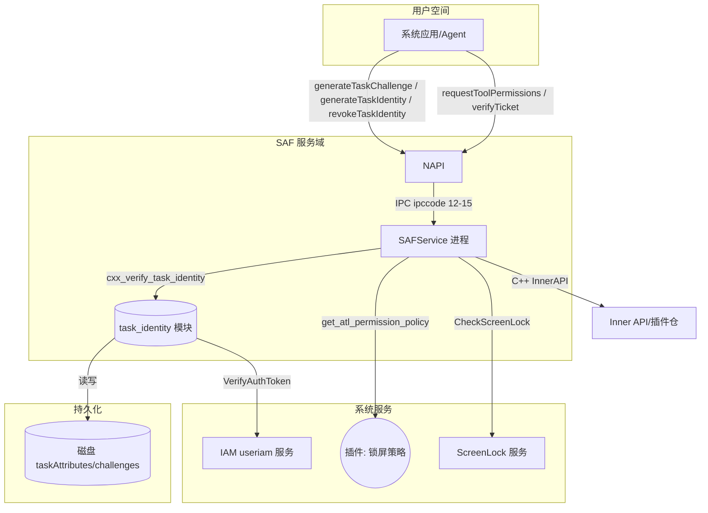

# 威胁模型分析

## 审批元数据

| 字段 | 内容 |
|------|------|
| Threat Model ID | THREAT-20260905541319 |
| 关联 Design | DESIGN-20260905541319（design.md「深度威胁分析」D-1 跟进项） |
| 关联 Spec | FEAT-20260905541319（spec.md，「安全与权限」=是） |
| 触发类别 | 修改认证/授权/权限模型（高风险判据） |
| 状态 | Approved |
| Approver | Lin Shen（Owner） |
| Evidence | Owner 审阅 P0/P1 缓解完整性与合规差距（D-3 闭环）；`execution-plan.md#Task 列表` 已验证 TH-001~TH-004/010-012 缓解落 Task |
| 批准日期 | 2026-10-24 |

## 变更范围概述

> 来自 proposal.md 的变更摘要，说明安全相关背景。

| 属性 | 值 |
|------|-----|
| 变更名称 | 任务级身份凭证支撑 Agent 长时/定时任务在锁屏下执行（FEAT-20260905541319） |
| 复杂度 | 复杂 |
| 安全/权限维度 | 是 |
| 敏感数据处理 | 是（任务身份凭证、机主认证 authToken(base64)、ATL 认证等级、callerTokenId） |

> **触发判定**：proposal「安全与权限」= 是，且命中"修改认证/授权/权限模型"高风险判据（新增任务级授权模型 + 锁屏豁免放行 + 机主认证绑定）；由 Owner 显式批准生成本模型（D-1）。

## 数据流图

### 信任边界说明

| 边界类型 | 边界描述 | 跨越的交互 |
|---------|----------|-----------|
| 用户空间 ↔ SAF 服务 | 系统应用/Agent 通过 Binder IPC 调用 SAF 服务 | ipccode 12-15、requestToolPermissions/verifyTicket |
| SAF 服务 ↔ IAM | 高危签发调用 useriam `VerifyAuthToken` 获取 (challenge, atl) | CXX 桥 |
| SAF 服务 ↔ 插件 | 查询锁屏拒绝权限策略（ATL→permissionPolicy）、授权策略 | plugin process_event（GetAtlPermissionPolicy） |
| SAF 服务 ↔ 持久化 | 任务凭证与待认证挑战值读写磁盘 | `/data/service/el2/{os_id}/secure_access_fence/agent_plugin/` |
| SAF 服务 ↔ ScreenLock | 锁屏状态检测（`needUnlockScreen` + `IsScreenLocked`） | cxx_is_screen_locked |

## STRIDE 威胁分析

> 优先级定义：P0=高影响+高/中可能性（本次必须解决）；P1=中/高影响+中可能性（本次应解决或计划）；P2=低/中影响+低可能性（可接受/后续）。

### ExternalEntity[外部实体：系统应用/Agent]

| 威胁类型 | 威胁场景 | 影响 | 可能性 | 现有控制 | 建议控制 | 优先级 | 关联 AC/Task |
|---------|----------|------|--------|----------|----------|--------|-------------|
| Spoofing | 非系统应用或未持 `QUERY_TOOL_PERMISSIONS` 的调用方冒用系统应用签发/撤销任务凭证 | High | Med | 服务侧 stub 独立鉴权：系统应用 + `QUERY_TOOL_PERMISSIONS`（spec AC-1.6）；Retrieve 另需系统 SA + `INTERACT_ACROSS_LOCAL_ACCOUNTS` | 保持服务侧双重校验作为唯一防线；客户端前置校验仅辅助 | P0 | AC-1.6, AC-4.2 |
| Spoofing | 低危路径（未携带 authToken）签发的任务凭证被用于高危/锁屏豁免场景 | High | Med | `allowScreenLockExecution` 与 `authToken` 均为任务属性一部分，被 HMAC 覆盖；锁屏豁免要求 hasAuthToken（design R-7） | 锁屏豁免判定强制校验凭证声明（AC-2.2）与 ATL>0 | P1 | AC-2.2 |

### Process(处理进程：SAFService / task_identity / permission_manager)

| 威胁类型 | 威胁场景 | 影响 | 可能性 | 现有控制 | 建议控制 | 优先级 | 关联 AC/Task |
|---------|----------|------|--------|----------|----------|--------|-------------|
| Tampering | 调用方篡改 `taskAttributes`（taskId/过期时间/executeType/allowScreenLockExecution/authToken）或 identity/challenge | High | High | 双 challenge HMAC，identity=base64(HMAC(taskAttributes+taskId+challenge2))，覆盖全部 taskAttributes | 校验端按同构重算比对（fetch_record_and_verify），篡改→Mismatch | P0 | AC-3.2, AC-3.3, AC-4.3 |
| Tampering | 磁盘上的任务凭证被攻击者直接修改 | Med | Low | 目录 0o750 / 文件 0o640 访问控制；HMAC 覆盖 taskAttributes | 定期安全审计；异常行为监控（篡改后校验失败可观测） | P2 | AC-3.3 |
| Elevation | 锁屏态下未达 ATL 的任务通过伪造 `allowScreenLockExecution=true` 获得锁屏放行 | High | Med | 锁屏豁免 = 声明 + ATL>0 + 待认证挑战值比对 + HMAC；ATL 捆绑于高危路径（真实 IAM 认证） | 锁屏放行必须校验凭证 ATL 有效（INV-5/INV-7；AC-2.2）；policyFound=false 一律不放行 | P0 | AC-2.2, AC-2.3 |
| DoS | 大量 create/revoke/verify 调用耗尽内存或磁盘 | Med | Med | LRU 32 内存上限（entries+challenges）；authToken≤4096；taskAttributes JSON≤8192；revoke taskIds≤100 | 保持配额上限；插件策略查询最小化 | P1 | AC-4.3, INV-6 |
| Info Disclosure | 校验失败错误信息泄露内部错误码细节/ATL 值 | Low | Low | 统一错误宏脱敏（log_throw_error! 不打印 authToken/identity 值） | 安全日志脱敏原则持续 | P2 | 全部 |

### Store[(数据存储：磁盘凭证/challenge)]

| 威胁类型 | 威胁场景 | 影响 | 可能性 | 现有控制 | 建议控制 | 优先级 | 关联 AC/Task |
|---------|----------|------|--------|----------|----------|--------|-------------|
| Info Disclosure | authToken(base64) 明文落盘被未授权进程读取 | High | Low | 目录 0o750 / 文件 0o640（内核阻止跨 UID 读取）；内置 SELinux 访问约束 | **D-3 跟进**：安全评审复核明文存储是否满足平台数据安全基线；必要时加密存储 | P1 | AC-3.3, INV-1 |
| Tampering | 攻击者删除/修改凭证记录导致有效性错乱 | Med | Low | HMAC 校验失败即拒绝；一次性任务删除后不可再通过 | 磁盘完整性低概率，靠 HMAC 兜底；审计 | P2 | AC-3.2 |
| DoS | 磁盘填充（大量 challenge 文件） | Med | Low | LRU 内存上限；challenge 10 分钟超时清理；on_idle 过期清理 | 保持磁盘清理策略；设置磁盘配额/水位告警 | P2 | INV-4, INV-6 |

### Flow[数据流：IPC / IAM 桥 / 插件]

| 威胁类型 | 威胁场景 | 影响 | 可能性 | 现有控制 | 建议控制 | 优先级 | 关联 AC/Task |
|---------|----------|------|--------|----------|----------|--------|-------------|
| Spoofing | IPC 参数（typedarray/authToken/taskId）越界或格式伪造 | Med | Med | NAPI typedarray 校验（u8 逐元素 0~255）；validator.rs 路径穿越/长度/数量校验；IPC 序列化 u8 范围校验 | 保持全部入口校验；新增字段同步 validator 与 napi 双端 | P1 | AC-1.7, AC-3.4 |
| Tampering | IAM 返回 challenge/atl 被中间层篡改 | Med | High | 真实 IAM `VerifyAuthToken`（跨进程可信服务）经 CXX 桥；待认证挑战值在签发侧比对 | 不信任任何本地模拟的 atl；高危必须走真实 IAM 路径 | P1 | AC-1.3, AC-1.4 |
| Repudiation | 调用方否认曾签发/撤销任务凭证 | Low | Low | 无审计日志（当前无 task 操作审计） | 补充关键操作审计事件（签发/撤销/豁免放行）——建议新增审计打点 | P2 | 全部 |
| Tampering | 插件返回伪造的锁屏策略（错误 PolicyFound / 空列表语义误用） | Med | Low | 服务侧字段校验（wrapper.rs:243：PolicyFound 必须布尔、PermissionPolicy 字符串列表、空串拦截、found=0 时忽略列表） | 保持服务侧不信任畸形插件响应；插件凭据/域约束由平台供应链保障 | P1 | AC-2.2, AC-2.3 |

## 威胁汇总

| 优先级 | 威胁数量 | 威胁 ID 列表 | 处理要求 |
|--------|----------|-------------|----------|
| P0 | 3 | TH-001（调用方冒用）、TH-003（锁屏豁免提权）、TH-004（凭证篡改） | 本次变更必须解决 |
| P1 | 5 | TH-002（低危凭证误用）、TH-006（磁盘 authToken）、TH-010（IPC 参数伪造）、TH-011（插件策略篡改）、TH-012（DoS 资源耗尽） | 本次变更应解决或制定明确计划 |
| P2 | 5 | TH-005（错误信息泄露）、TH-007（磁盘篡改）、TH-008（磁盘填充）、TH-009（抵赖/审计缺失）、TH-013（低危路径命令注入类） | 可后续优化或接受风险 |

### 高优先级威胁详细说明

#### TH-001: 非授权调用方冒用系统应用签发/撤销任务凭证

**威胁类型**: Spoofing
**目标元素**: ExternalEntity（系统应用）
**攻击场景**: 第三方应用或未持权限 SA 调用 `generateTaskChallenge`/`generateTaskIdentity`/`revokeTaskIdentity`/`RetrieveAuthTokenByTaskId` 伪造任务授权。
**影响**: 未授权任务被执行；凭证被滥用。
**验证方法**: 无权限调用返回 201；非系统应用返回 202（spec AC-1.6/AC-4.2）。
**缓解措施**: 服务侧 stub 独立鉴权为唯一防线（OH-ARCH-IPC-SAF）；`RetrieveAuthTokenByTaskId` 双重权限（系统 SA + QUERY + INTERACT_ACROSS_LOCAL_ACCOUNTS）。→ TASK-1

#### TH-003: 锁屏豁免被提权滥用（伪造 allowScreenLockExecution / 伪造 ATL）

**威胁类型**: Elevation of Privilege
**目标元素**: Process（permission_manager 锁屏豁免判定）
**攻击场景**: 攻击者构造 `allowScreenLockExecution=true` 的低危凭证（或无 ATL），试图在锁屏态触发豁免放行。
**影响**: 锁屏保护被绕过，未完成机主认证的任务得以执行。
**验证方法**: 锁屏态豁免条件矩阵遍历：无 taskIdentity / allowScreenLockExecution=false / ATL<=0 / policyFound=false / 命中拒绝列表 → 24010006（AC-2.2/AC-2.3）。
**缓解措施**: 锁屏豁免=凭证声明 + ATL>0 + 待认证挑战值比对 + HMAC 完整校验（INV-5/INV-7）；`allowScreenLockExecution` 与 ATL 均在 HMAC 覆盖的 `taskAttributes` 内，无法单独伪造。→ TASK-2, TASK-4

#### TH-004: 任务凭证被篡改（HMAC 攻击目标）

**威胁类型**: Tampering
**目标元素**: Flow / Store（凭证签发与校验）
**攻击场景**: 攻击者篡改 `taskAttributes`（延长过期时间、改 executeType、注入 allowScreenLockExecution）或替换 identity/challenge。
**影响**: 过期/复用/越权任务被执行；一次性语义被破坏。
**验证方法**: 篡改 identity/challenge/taskAttributes 后校验必须失败（24010002，内部 Mismatch）；一次性任务篡改后二次校验失败（AC-3.2/AC-3.3/AC-4.3）。
**缓解措施**: 双 challenge HMAC 全量覆盖 `taskAttributes`+taskId+challenge2；校验端按同构重算（fetch_record_and_verify）；会话密钥经 create_ticket_key_manager 派生（复用基线）。→ TASK-2

## 法规合规检查

### 个人信息保护法

| 检查项 | 要求 | 状态 | 证据/措施 | 关联 AC/Task |
|--------|------|------|-----------|-------------|
| **最小必要原则** | 仅收集功能必需的数据 | ✅ | 仅存任务身份必要字段（taskId/expire/executeType/allowScreenLock/ATL/authToken），无额外 PII | 全流程 |
| **知情同意** | 明确告知用户并获得同意 | ✅ | 任务执行由用户主动授权（机主认证/任务授权），不采集生物特征原始值 | AC-2.1 |
| **匿名化/去标识化** | 提供技术方案 | ✅ | 凭证以 HMAC + callerTokenId 关联，不存明文用户身份 | 全流程 |
| **用户权利** | 支持访问、更正、删除、撤回同意 | ✅ | `revokeTaskIdentity` 支持任务撤回（AC-1.5） | AC-1.5 |
| **数据处理规则** | 公开处理规则 | ✅ | 系统级安全能力，无面向个人数据处理规则声明义务（用途限于授权任务执行） | 全流程 |

### 数据安全法

| 检查项 | 要求 | 状态 | 证据/措施 | 关联 AC/Task |
|--------|------|------|-----------|-------------|
| **数据分类分级** | 按敏感度分类并实施保护 | ⚠️ | authToken(base64)/ATL 属敏感授权凭据；当前明文落盘（已确认接受），需按平台分类分级复核（D-3） | TH-006, D-3 |
| **数据出境安全** | 评估并通过安全评估 | N/A | 无跨境数据流（纯本地 IPC/存储） | — |

### 网络安全法

| 检查项 | 要求 | 状态 | 证据/措施 | 关联 AC/Task |
|--------|------|------|-----------|-------------|
| **等级保护** | 满足对应等级保护要求 | ✅ | 系统服务遵循既有 SAF 组件等级保护基线；新增授权模型按同等级管控 | 全流程 |
| **关键信息基础设施** | 特殊保护措施（如适用） | N/A | 非关键信息基础设施单点 | — |

### GDPR（如适用）

N/A — 本变更仅本地系统能力，无欧盟个人数据处理与跨境处理。

### 合规差距汇总

| 法规 | 差距项 | 影响 | 缓解计划 | 关联 Task |
|------|--------|------|----------|-----------|
| 数据安全法 | authToken 明文落盘（分类分级口径） | 授权凭据泄露面 | 安全评审复核（D-3）；必要时升级存储保护 | TASK-3 |

## 风险与缓解

| 风险/威胁 ID | 类型 | 可能性 | 影响 | 缓解措施 | 验证方法 | 关联 Task | 状态 |
|-------------|------|--------|------|----------|----------|-----------|------|
| TH-001 | Spoofing | Med | High | 服务侧独立鉴权（系统应用+权限；Retrieve 双重权限） | 单测 201/202 | TASK-1 | Open |
| TH-002 | Spoofing | Med | High | 锁屏豁免强制校验凭证声明与 ATL | 矩阵用例 | TASK-4 | Open |
| TH-003 | Elevation | Med | High | 豁免=声明+ATL>0+challenge 比对+HMAC；24010006 拦截 | 矩阵遍历 | TASK-2, TASK-4 | Open |
| TH-004 | Tampering | High | High | 双 challenge HMAC 全量覆盖；校验重算 | 篡改注入用例 | TASK-2 | Open |
| TH-005 | Info Disclosure | Low | Low | 错误宏脱敏 | hilog 检查 | 全部 | Open |
| TH-006 | Info Disclosure | Low | High | 目录 750/文件 640；D-3 复核加密 | 文件权限检查+安全评审 | TASK-3 | Open |
| TH-007 | Tampering | Low | Med | HMAC 校验失败即拒绝 | 篡改用例 | TASK-2 | Open |
| TH-008 | DoS | Low | Med | LRU 32 + 10min challenge 超时 + 过期清理 | 压测 | TASK-3 | Open |
| TH-009 | Repudiation | Low | Low | 建议补充签发/撤销/豁免审计打点 | 审计日志 | TASK-5 | Open |
| TH-010 | Spoofing | Med | Med | NAPI+validator+IPC 三端参数校验 | 边界用例 | TASK-1, TASK-2 | Open |
| TH-011 | Tampering | Low | Med | 插件响应字段校验（wrapper.rs:243） | 畸形响应测试 | TASK-4 | Open |
| TH-012 | DoS | Med | Med | LruMap+配额上限 | 高并发压测 | TASK-3 | Open |
| TH-013 | Elevation | Low | Med | 低危路径凭证不可用于锁屏豁免（无 ATL） | 矩阵用例 | TASK-4 | Open |
| COMP-001 | 合规差距 | Low | Med | authToken 存储分类分级复核 | 安全评审 | TASK-3 | Open |

## 安全验证计划

| 验证项 | 验证方法 | 预期结果 | 关联 Task |
|--------|----------|----------|-----------|
| 调用方鉴权（TH-001） | 单测：无权限/非系统应用调用 | 201/202 | TASK-1 |
| 凭证篡改（TH-004） | 篡改 identity/challenge/taskAttributes 注入 | 校验失败 24010002 | TASK-2 |
| 锁屏豁免提权（TH-003） | 豁免条件矩阵（声明/ATL/policy/拒绝列表） | 仅在全部满足放行；否则 24010006 | TASK-4 |
| 一次性消费（一次性） | INSTANT 校验后二次校验 | 失败；DELAYED 可重复 | TASK-5 |
| 插件策略畸形（TH-011） | 伪造插件响应 | 服务侧拒绝 InvalidArgument | TASK-4 |
| 存储保护（TH-006/COMP-001） | 文件权限检查 + 安全评审 | 750/640；D-3 结论闭环 | TASK-3 |
| 资源耗尽（TH-008/TH-012） | 高并发/大任务量压测 | LRU 有界不 OOM；磁盘不填充 | TASK-3 |
| 审计可用性（TH-009） | 关键操作审计打点检查 | 签发/撤销/豁免放行可追溯 | TASK-5 |

## 安全建议

### 设计阶段建议

- 锁屏豁免判定统一收敛到单一入口（permission_manager），避免 `RetrieveAuthTokenByTaskId` 被误作唯一豁免判定点（design 已约束）。
- authToken 存储保护方案需在 Plan 前与安全基线对齐（D-3）。

### 实现阶段建议

- 保持 NAPI/validator/IPC 三端边界校验同步（新增字段不得漏查）。
- 将 `MAX_ALLOWABLE_DURATION=86400` 收敛至声明口径 `(0,60]`（D-2）。

### 测试阶段建议

- 为 TH-001~TH-004/TH-011 编写 XTS/测试 HAP 场景（spec 验证映射 VM-1~15 承接）。
- 安全回归覆盖：锁屏豁免矩阵 + 篡改注入 + 一次性消费 + 插件畸形响应。

## 附录：威胁建模方法论

### STRIDE 方法论

STRIDE 是微软开发的威胁建模方法，涵盖六大威胁类型：

- **Spoofing（伪装）**: 攻击者冒充合法用户或组件
- **Tampering（篡改）**: 数据或代码被未授权修改
- **Repudiation（抵赖）**: 用户否认其操作
- **Information Disclosure（信息泄露）**: 敏感信息暴露给未授权方
- **Denial of Service（拒绝服务）**: 服务可用性被破坏
- **Elevation of Privilege（权限提升）**: 攻击者获得更高权限

### DFD 元素与威胁对应

| DFD 元素 | 适用威胁类型 |
|---------|-------------|
| External Entity | Spoofing, Repudiation |
| Process | Spoofing, Tampering, Repudiation, Information Disclosure, DoS, Elevation |
| Data Store | Tampering, Information Disclosure, DoS |
| Data Flow | Spoofing, Tampering, Repudiation, Information Disclosure, DoS |

### 参考资源

- Microsoft Threat Modeling Tool: https://www.microsoft.com/en-us/security/blog/threat-modeling-tool/
- OWASP Threat Modeling: https://owasp.org/www-community/Threat_Modeling
- STRIDE per Element: https://docs.microsoft.com/en-us/azure/security/develop/threat-modeling-threats