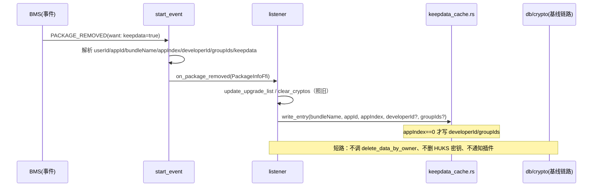
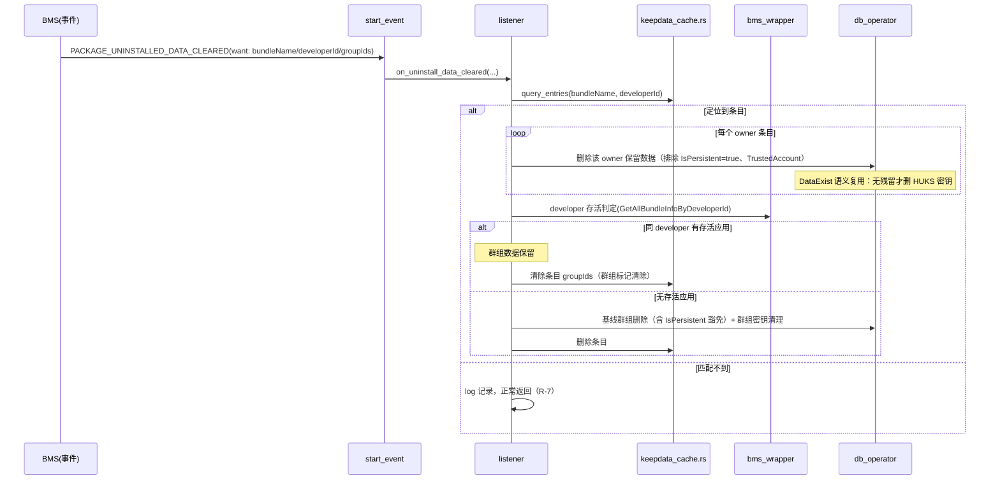

# 架构设计

> 确认目标仓和模块的架构约束、关键设计决策、Spec 拆分方向。

## 设计元数据

| 字段 | 内容 |
|------|------|
| Design ID | DESIGN-20260916754428 |
| 关联需求 | `.codespec/changes/20260916754428/proposal.md` |
| 关联 Epic | 无 |
| 目标 Feature | FEAT-20260916754428（Asset 适配用户卸载保留数据） |
| 复杂度 | 复杂 |
| 目标版本 | OpenHarmony 7.1（proposal.target_release，P3） |
| Owner | yin yaode |
| 状态 | Approved（yin yaode，2026-11-13） |

## 需求基线

> 需求基线详见 proposal.md。以下仅列出设计阶段需要额外强调的要点。

| 项 | 补充说明 |
|----|----------|
| 保留语义完整性 | keepdata=true 时**短路整条基线删除链路**（数据、HUKS 密钥、插件通知均不执行；C-1 已确认不通知插件） |
| 标记位字段 | appId / appIndex / developerId / groupIds（后两项仅 appIndex==0 记录，proposal Q-10）；**设计偏差：额外记录 bundleName** 作为清理事件 join key（见 ADR-2） |
| 群组混合 keepdata | 任一群组 HAP 卸载带过 keepdata → 全部卸载后群组保留（proposal Q-11）；判定依据 = 当前卸载 keepdata 或标记命中（ADR-3） |
| IS_PERSISTENT 豁免 | 清理事件删除时库内 `IsPersistent=true` 记录豁免（proposal Q-2）；设计将其统一适用于 owner 与群组删除（ADR-4，已确认 2026-11-13） |
| 事件参数名 | 复用既有 want 常量风格（`start_event.rs:28-35`）；keepdata 字段名按需求原文 "keepdata"，**参数名需与 BMS 最终实现对齐**（风险 R-1） |

## 上下文和现状

### 涉及仓和模块

| 仓库 | 补充架构说明 |
|------|-------------|
| `security_asset` | 唯一实现仓。本设计涉及：SA 按需事件入口（start_event/listener）、db_operator 删除链路、crypto_manager HUKS 密钥清理、新增 keepdata 标记存储模块、sa_profile 事件订阅。无跨仓改动（BMS 复用现有 FFI）。 |

### 代码事实基线

> 只记录**基线中已有、本次设计必须兼容/复用的现状**（文件:行/符号，源码验证）。

| 代码引用（文件:行/符号） | 基线现状事实 | 对本设计的约束 | 验证来源/可信度 |
|-------------------------|------------|----------------|-----------------|
| `core_service/src/common_event/start_event.rs:28-35` | want 参数常量：`userId`/`appId`/`bundleName`/`developerId`/`assetAccessGroups`/`appIndex`/`sandbox_app_index` | keepdata 与清理事件解析沿用同一常量风格；`GROUP_IDS` 的实际 key 是 `assetAccessGroups` | 源码，高 |
| `start_event.rs:98-127 / handle_package_removed`、`:129-141 / process_common_event_async` | PACKAGE_REMOVED/SANDBOX 按需拉起 → want 解析 → `on_package_removed`；事件路由为平铺 if-else | 清理事件新增同级分支；keepdata 在 `PackageInfo`/`PackageInfoFfi` 增字段传递 | 源码，高 |
| `listener.rs:101-114 / delete_in_de_db_on_package_removed`、`:105 IS_PERSISTENT=false 删除条件` | **基线删除条件已含 `IsPersistent=false`**（即"开发者卸载保留"豁免在卸载链路已存在）+ reverse_condition 排除 TrustedAccount + 无残留时 remove_db | keepdata 分支在其外层短路；清理链路**直接复用**该删除内核（豁免条件已天然满足，无需扩展） | 源码，高 |
| `listener.rs:169-219 / construct_calling_infos`、`:190 GetUninstallGroups` | 群组 calling_info 构造依赖 BMS 查询"该群组 HAP 是否全部卸载" | 群组保留判定插在群组删除决策处（ADR-3） | 源码，高 |
| `os_dependency/src/bms_wrapper.cpp:335-356 / GetUninstallGroups` | 内部走 `GetAllBundleInfoByDeveloperId`（developer 粒度存活查询现成） | 清理事件群组判定复用同一链路，不新增 FFI | 源码，高 |
| `db_operator/src/database_file_upgrade.rs:287-294 / fmt_file_path`、`:302-341 / create_upgrade_file/get_file_content` | 既有缓存文件模式：`{DE_ROOT_PATH}/{user_id}/upgrade.cache` + 全局文件锁 + 0o640 + serde | keepdata.cache 直接复用该模式（ADR-2） | 源码，高 |
| `db_operator/src/types.rs / IS_PERSISTENT`（column，DataType::Bool） | 库内既有持久化标记列 | 清理豁免条件直接引用该列 | 源码，高 |
| `listener.rs:240-248 / SecretKey::delete_by_owner` 调用 | 密钥清理入口（owner/group 各自调用） | keepdata 路径不调用；清理路径按"删除后无残留"复用 | 源码，高 |
| `sa_profile/8100.json:14-15` | SA 按需事件订阅清单（含 PACKAGE_REMOVED/SANDBOX） | 清理事件在此注册 | 配置，高 |
| `listener.rs:279 / update_upgrade_list`、`:232 / clear_cryptos` | 卸载时更新升级列表、清理内存 crypto 会话 | 两项**不属于保留数据范围**，keepdata 路径照旧执行（ADR-6） | 源码，高 |

### 调用链层级分析

| 层 | 模块 | 职责 | 修改类型 |
|----|------|------|----------|
| 事件入口 | `start_event.rs` | keepdata 解析；`PACKAGE_UNINSTALLED_DATA_CLEARED` 路由与 want 解析 | 修改 |
| 事件处理 | `listener.rs` | keepdata 保留分支（短路删除 + 写标记）；清理链路编排（定位→删除→密钥→标记消费） | 修改 |
| 标记存储 | `services/asset/db_operator/src/keepdata_cache.rs`（新增，复用 upgrade.cache 代码模式） | keepdata.cache 读写/匹配/条目消费 | 新增 |
| db 删除内核 | `db_operator`（delete 链路） | 数据删除；清理路径新增 `IsPersistent=true` 豁免条件 | 修改 |
| BMS | `bms_wrapper`（GetUninstallGroups / GetAllBundleInfoByDeveloperId） | 群组/developer 存活判定 | 复用 |
| HUKS | `crypto_manager`（SecretKey::delete_by_owner） | 密钥清理 | 复用（条件化调用） |
| SA 配置 | `sa_profile/8100.json` | 新事件订阅 | 修改 |

**检查项：**
- [x] 调用链每一层都已覆盖（事件入口 → 事件处理 → 标记存储 → db/BMS/HUKS）
- [x] 每层职责边界清晰：标记存储不进查询路径；删除内核不感知标记
- [x] 每层修改类型明确

### 适用架构规则

| Rule ID | 适用原因 | 设计结论 | 验证方式 |
|---------|----------|----------|----------|
| 事件入口收敛 | keepdata 判定与清理触发均只发生在 SA 按需事件链路 | 业务 API 路径（add/query/update/remove）零改动、零标记依赖（spec 架构约束） | 代码评审/回归 |
| 文件权限与锁 | 新增持久化文件 | 复用 upgrade.cache 模式：全局文件锁 + 0o640 + serde | 单测/设备检查 |
| 错误处理 | 事件处理 best-effort | 标记读写失败仅记日志不中断主流程；事件解析失败 log 后返回（R-7/R-8） | 单测/容错用例 |
| 密钥-数据强绑定 | spec R-10 | 保留路径一律不删密钥；清理路径删除后按"无残留才删密钥"判定 | 用例断言 |

### 既有模式复用

| 模式 | 参考代码（文件:行/符号） | 必须复用的约定 | 本设计的复用方式 | 偏差及理由 |
|------|-------------------------|----------------|------------------|------------|
| 缓存文件 | `database_file_upgrade.rs:287-341`（路径/锁/权限/serde） | `{DE_ROOT_PATH}/{user_id}/<name>.cache`、全局文件锁、0o640 | `keepdata.cache` 同构实现（独立 KEEPDATA_FILE_LOCK） | 无 |
| want 常量解析 | `start_event.rs:28-35` | 常量名集中定义、parse 失败 log_throw_error | keepdata/清理事件参数同风格 | 无 |
| BMS 群组/developer 查询 | `bms_wrapper.cpp:335`、`listener.rs:190` | FFI 包装与错误映射 | 清理事件群组判定复用 | 无 |
| 日志与错误宏 | `macros_lib::log_throw_error!` / logi/loge | 统一日志 | 直接复用 | 无 |

## 不涉及项承接

| 维度 | 设计结论 |
|------|----------|
| 性能 | 事件低频冷路径；查询路径零改动。标记文件读写仅发生在卸载/清理事件（单次全量重写，体量 KB 级） |
| 安全/权限 | 标记文件 0o640、内容仅标识符（无敏感数据）；保留数据隔离/加密体系不变；见「安全基础检查」 |
| 兼容性 | 不带 keepdata 走原代码路径（分支不进入）；标记文件为新增文件，无迁移；回退残留幂等 |
| 构建/组件 | 仅 `core_service` 新增源文件与 `sa_profile/8100.json` 配置项，无依赖变更 |

## 关键设计决策

| 决策 ID | 问题 | 推荐方案 | 探索过的替代方案 | 取舍理由 | 影响 |
|---------|------|----------|-----------------|------|------|
| ADR-1 | keepdata 保留分支的短路位置 | 在 `on_package_removed` **顶层分流**：keepdata=true → 写标记 + 跳过 `delete_data_by_owner` 与插件通知；`update_upgrade_list`/`clear_cryptos` 照旧 | A：在 `delete_data_by_owner` 内部逐 calling_info 条件化——侵入删除内核，群组/密钥逻辑分散易漏 | 顶层分流对基线路径零侵入（keepdata=false 不进入新代码）；保留语义一目了然 | listener.rs 入口；TASK-2 |
| ADR-2 | 标记文件设计 | **`db_operator/src/keepdata_cache.rs`**（新增模块）：独立 `{DE_ROOT_PATH}/{user_id}/keepdata.cache` 文件，**完全复用 upgrade.cache 的代码模式**（lazy_static 文件锁 + 0o640 + OpenOptions + ylong_json serde），条目 = `{bundleName, appId, appIndex, developerId?, groupIds?}`（后两项仅 appIndex==0）；同 (appId,appIndex) 重复保留时刷新条目。**与 upgrade.cache 用途不同，互不混用**（Owner 评审结论）；serde 为 db_operator 既有依赖，core_service 零改动 | A：扩展 UpgradeData 混入 upgrade.cache——**被否**（两者用途完全不同，Owner 评审）；B：入库（表/列）——事务一致但侵入全部库 schema；C：每 owner 独立小文件——文件数膨胀 | 独立文件保持用途隔离；代码模式与既有实现同构（get_file_content/save_to_writer/条目 retain 同款写法）；**较 proposal Q-10 增加 bundleName 字段**（清理事件 join key，appId 不可由 bundleName 推导；清理定位用标记内 appId 直接拼 db 名，不依赖重装后 appId 是否变化） | db_operator/keepdata_cache.rs；TASK-1 |
| ADR-3 | 群组混合 keepdata 的保留判定 | ① keepdata=true 卸载：整链短路（含群组）+ 标记条目携带 groupIds 即群组保留凭据；② keepdata=false 卸载且 `GetUninstallGroups` 判定某群组可删：**删除前查标记**——存在同 developerId 且 groupIds 覆盖该群组的条目 → 跳过该群组删除（数据保留） | A：卸载时实时向 BMS 查询历史 keepdata 记录——BMS 无此接口；B：为群组单设标记文件——两处状态易失一致 | 标记条目天然兼任群组保留凭据（Q-11 语义：任一带过即保留）；无新增状态 | listener.rs 群组循环；TASK-3 |
| ADR-4 | 清理事件的执行内核 | 复用 `delete_on_package_removed` 删除内核：**基线删除条件已含 `IsPersistent=false`（listener.rs:105）与 TrustedAccount 反向条件**，豁免天然成立、无需扩展；DataExist 语义不变（IS_PERSISTENT/TrustedAccount 残留 → 不删密钥）；处理完删除标记条目 | A：新写清理 SQL——重复删除逻辑两份；B：群组不豁免 IS_PERSISTENT——与"开发者声明卸载保留"语义冲突 | 单一删除内核直接复用（plan 阶段核实：豁免条件基线已存在，较设计初稿"需扩展"进一步简化）；密钥联动自动满足 R-10 | db_operator 豁免条件（实际零改动）；TASK-4 |
| ADR-5 | 清理事件的群组判定 | `GetAllBundleInfoByDeveloperId` 查 developer 存活：有存活应用 → 群组数据保留、清除相关群组标记（groupIds 从条目移除）；无存活 → 基线群组删除（含 IS_PERSISTENT 豁免）+ 群组密钥清理 | A：只按事件 groupIds 无脑删——违反"同 developer 有应用则保留"（spec R-5） | 复用 BMS 既有能力（proposal Q-12）；判定与 spec AC-2.3/2.4 一一对应 | listener.rs 清理链路；TASK-4 |
| ADR-6 | keepdata 路径对 `clear_cryptos`/`update_upgrade_list` 的处理 | **照旧执行**（不短路）：内存 crypto 会话与升级列表不属于"数据保留"范围；会话清理反而降低驻留敏感状态 | A：全部保留——内存 challenge 残留无意义且增敏感面 | 保留范围严格限定为持久化数据 + HUKS 密钥 | listener.rs；TASK-2 |
| ADR-7 | 标记与容错 | 标记读写失败：log 后继续事件主流程（保留数据仍保留/清理照常尽力）；清理事件按 bundleName 匹配不到条目：log 后正常返回 | A：失败即重试/入队——事件无重试基础设施，低频场景收益低 | best-effort 与 spec R-7/R-8 对齐；最坏后果=清理遗漏（多保留），无误删 | keepdata_cache.rs；TASK-1/4 |

## 设计骨架

### 骨架范围

| 骨架项 | 目标 | 不包含 | 验证方式 |
|--------|------|--------|----------|
| keepdata_cache.rs 模块骨架 | 条目结构/读写/匹配/消费 API + 单测 | 事件接入 | cargo test |
| 事件链路骨架 | start_event 路由 + listener 分支桩函数编译通过 | 完整清理逻辑 | cargo build |

### 后续 Task 拆分

| Task ID | 目标 | 受影响文件 | 依赖 |
|---------|------|------------|------|
| TASK-1 | keepdata.cache 存储模块（结构/锁/权限/读写/匹配/消费/损坏容错）+ 单测 | `db_operator/src/keepdata_cache.rs`、`db_operator/src/lib.rs`（mod 注册） | design Approved |
| TASK-2 | keepdata 解析 + 保留分支（顶层短路 + 写标记） | `start_event.rs`、`PackageInfo(Ffi)`、`listener.rs` | TASK-1 |
| TASK-3 | 群组保留判定（keepdata=false 群组删除前的标记命中检查） | `listener.rs`（construct_calling_infos/delete 编排） | TASK-1 |
| TASK-4 | 清理链路（事件路由 → 标记定位 → 删除（IS_PERSISTENT 豁免）→ 密钥 → 群组判定 → 标记消费） | `start_event.rs`、`listener.rs`、`db_operator`（豁免条件） | TASK-1 |
| TASK-5 | sa_profile 注册 + 模块测试用例（VM-1~VM-8 对应） | `sa_profile/8100.json`、`test/asset/unittest/module_test` | TASK-2/3/4 |

## API 签名、Kit 与权限

无新增/变更/废弃 API（spec「API 变更分析」）。无 Kit/d.ts/权限改动。

## 构建系统影响

### BUILD.gn 变更

```
无。db_operator BUILD.gn 为 root-only sources 模式（sources = ["src/lib.rs"]），新模块经 lib.rs 的 mod 声明自动纳入；serde/ylong_json 为 db_operator 既有依赖。
```

### bundle.json 变更

无（无新增外部依赖）。

### sa_profile 变更

```
文件路径: sa_profile/8100.json
变更说明: events 数组新增 "usual.event.PACKAGE_UNINSTALLED_DATA_CLEARED" 按需拉起订阅。
```

## 可选设计扩展

### 时序设计

**keepdata 卸载保留：**



**清理事件（延迟清理）：**



### 数据模型设计

```rust
// db_operator/src/keepdata_cache.rs
struct KeepdataEntry {
    bundle_name: String,
    app_id: String,       // 定位 owner db（卸载时点值，不依赖重装后变化）
    app_index: i32,
    developer_id: Option<String>,  // 仅 app_index == 0 时记录
    group_ids: Option<Vec<String>>, // 仅 app_index == 0 时记录
}
struct KeepdataCache { entries: Vec<KeepdataEntry> }  // serde_json 序列化
```

API：`write_entry(user_id, entry)`（同 key 刷新）、`query_entries(user_id, bundle_name, developer_id) -> Vec<KeepdataEntry>`、`remove_group_ids(user_id, developer_id, group_ids)`、`remove_entries(user_id, entries)`、文件损坏时返回空表并重建（R-8）。

### 状态归属与不变量

| 状态 | 归属 | 不变量 |
|------|------|--------|
| 保留标记 | keepdata.cache（source of truth） | 条目存在 ⇒ 对应 owner 数据处于"卸载保留待清理"态 |
| owner 数据/密钥 | db 文件 / HUKS | keepdata=true 事件处理后：数据与密钥均存在（强绑定，spec R-10） |
| 群组保留凭据 | 条目 groupIds 字段 | 群组数据被保留 ⇒ 存在覆盖该群的标记条目（或保留发生在群组未全卸载的基线态） |

### 线程与并发模型

- 事件处理沿用现有 SA 按需拉起线程模型（`process_common_event_async`）
- `keepdata.cache` 访问统一经 `KEEPDATA_FILE_LOCK`（static Mutex，参照 `GLOBAL_FILE_LOCK` 模式），读-改-写全程持锁
- 标记写发生在删除短路决策之后（失败不影响保留事实，仅丢凭据）

### 安全基础检查

| 项 | 结论 |
|----|------|
| 标记文件权限 | 0o640（对齐 upgrade.cache）；目录为既有 DE per-user 目录 |
| 标记内容 | 仅标识符（bundleName/appId/appIndex/developerId/groupIds），无 secret/token |
| 保留数据隔离 | 未改动任何权限校验/owner 判定路径（隔离与基线一致，spec R-11） |
| 密钥生命周期 | keepdata 不删、清理后无残留才删（复用基线判定）；无"密钥先删"窗口 |
| 威胁面变化 | 新增文件仅 Asset SA 进程读写（目录权限继承）；无新 IPC/API 面 |

## 风险和开放问题

> 除 R-7 外，以下各项已于 2026-11-13 由 Owner（yin yaode，对话）确认按建议方案处理。

| # | 风险/开放问题 | 影响 | 缓解（已确认方案） | 确认状态 |
|---|--------------|------|-------------------|----------|
| R-1 | keepdata 字段名与取值载体（bool vs 字符串 "true"/"false"）需与 BMS 最终实现对齐 | 入口判定错误（全走错分支） | 按需求原文 "keepdata" 实现；解析层宽松转换（"true"/true 均接受）；联调前以 BMS 事件文档核对 | ✅ 已确认 |
| R-2 | 清理事件参数名（groupIds 是否仍为 `assetAccessGroups`）待核对 | 清理定位失败（R-7 容错路径） | 按现有 want 常量风格实现；解析失败 log 输出缺失字段名便于现场定界 | ✅ 已确认 |
| R-3 | appId 重装后是否变化 | 清理定位用**标记内 appId**（卸载时点值）拼 db 名，不依赖重装后 appId——已消解；剩二次 keepdata 卸载的新旧条目合并 | 条目按 (appId, appIndex) 刷新合并，TASK-1 单测覆盖 | ✅ 已确认 |
| R-4 | 标记文件非原子写（断电丢标记） | 清理遗漏（数据多保留），无误删 | **接受普通写，不做原子化**（后果符合 spec R-8 容错边界） | ✅ 已确认 |
| R-5 | IS_PERSISTENT 豁免统一适用于群组清理（设计选择，超出需求字面） | 群组内开发者保留数据被清（若不豁免） | **豁免**（与"卸载也保留"语义一致） | ✅ 已确认 |
| R-6 | clone 应用（appIndex>0）keepdata 卸载不记录 groupIds（proposal Q-10 规则） | 该场景群组保留凭据缺失 → 群组按基线删除 | **接受该边界**（需求方已定字段规则）；VM-2 补充边界用例 | ✅ 已确认 |
| R-7 | proposal `approval.baseline_digest` 占位（本地无 `ohos-sdd approval-digest` 工具） | 无"批准封印"，不影响文档内容与阶段推进 | 工具环境可用时对最终基线生成摘要回填 | 待工具环境 |

## 设计审批

> 已由 Owner（yin yaode）于 2026-11-13 批准（对话确认；R-1~R-6 按确认方案执行，R-7 忽略/占位保留）。批准后进入 Plan（execution-plan.md）。
